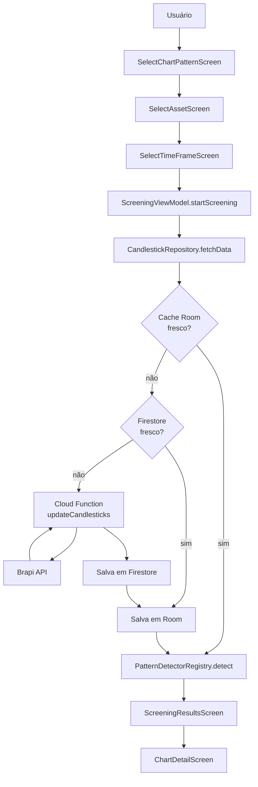

# ChartPatternTracker — Rastreador de Padrões Gráficos

> Automatizando a busca por padrões gráficos no mercado financeiro.

[](https://developer.android.com)
[](https://kotlinlang.org)
[](https://developer.android.com/jetpack/compose)
[](https://firebase.google.com)
[](https://m3.material.io)
[](#licenca)

---

## Sumário

1. [Sobre o projeto](#sobre-o-projeto)
2. [Demonstração](#demonstracao)
3. [Funcionalidades](#funcionalidades)
4. [Padrões de candlestick suportados](#padroes-de-candlestick-suportados)
5. [Arquitetura](#arquitetura)
6. [Fluxo de dados](#fluxo-de-dados)
7. [Stack tecnológico](#stack-tecnologico)
8. [Pré-requisitos](#pre-requisitos)
9. [Configuração e instalação](#configuracao-e-instalacao)
10. [Estrutura do repositório](#estrutura-do-repositorio)
11. [Cloud Function](#cloud-function)
12. [Internacionalização](#internacionalizacao)
13. [Testes](#testes)
14. [Identidade visual](#identidade-visual)
15. [Segurança e privacidade](#seguranca-e-privacidade)
16. [Limitações conhecidas](#limitacoes-conhecidas)
17. [Como contribuir](#como-contribuir)
18. [Licença](#licenca)
19. [Autor](#autor)
20. [Referências do TCC](#referencias-do-tcc)

---

## Sobre o projeto

O **ChartPatternTracker** é um aplicativo Android nativo, escrito em Kotlin com Jetpack Compose, que automatiza a detecção de **padrões de candlestick** em ativos do mercado financeiro brasileiro (B3) e exibe gráficos interativos para apoiar a tomada de decisão de traders.

Iniciativa originada como **Trabalho de Conclusão de Curso (TCC)** da Pós-Graduação em **Desenvolvimento de Sistemas para Dispositivos Móveis** do **Instituto Federal de São Paulo (IFSP) — Campus São Carlos** (autor: **Rodolfo Pereira de Andrade**, orientador: **Prof. Dr. Pedro Nobile**), atualmente em transição para **produto comercial**, com lançamento Beta planejado na Google Play e roadmap de monetização (ver [`ROADMAP.md`](ROADMAP.md)).

### O problema

Traders precisam monitorar dezenas de ativos simultaneamente em diferentes timeframes para identificar padrões de candlestick. Fazer isso manualmente é lento, cansativo e sujeito a erros — e a maioria das soluções existentes vive em plataformas web ou em scripts complexos.

### A proposta de valor

- **Primeiro app mobile nativo** com varredura automática de padrões em múltiplos ativos e timeframes.
- **Jornada guiada** em três passos simples: escolher padrões → escolher ativos → escolher timeframes.
- **Visualização interativa** dos resultados com gráfico de candlestick e marcação dos padrões.
- **Modo offline** com cache em duas camadas (Room + Firestore) para uso sem internet.

### Público-alvo

- **Traders iniciantes** — aprendizado guiado, descrições visuais dos padrões e interface didática.
- **Traders experientes** — agilidade, automação e varredura em lote para múltiplos ativos.

---

## Demonstração

<!-- TODO: adicionar screenshots das principais telas -->

| Tela | Descrição |
|------|-----------|
| Login | Autenticação com e-mail/senha ou Google |
| Menu Principal | Acesso rápido às funcionalidades |
| Seleção de Padrões | Escolha múltipla com busca |
| Seleção de Ativos | Tickers da B3 com logos |
| Seleção de Timeframes | Múltiplos intervalos simultâneos |
| Resultados | Lista de ocorrências com confiabilidade |
| Detalhe do Gráfico | Candlestick interativo com pattern destacado |

---

## Funcionalidades

### Autenticação
- Login com **e-mail e senha** (Firebase Authentication).
- Login com **Google Sign-In** (OAuth 2.0).
- Cadastro de novos usuários.
- Logout com limpeza de sessão Google.

### Catálogo de padrões
- 10 detectores de padrões implementados (registro extensível via `PatternDetectorRegistry`).
- Metadados multilíngues por padrão (nome, descrição, indicação, confiabilidade).
- Busca em tempo real e seleção múltipla.

### Seleção de ativos
- Listagem dinâmica de ativos da B3 via API **Brapi**.
- Cache local (Room) e remoto (Firestore) de metadados (`shortName`, `longName`).
- Logos carregados sob demanda (Coil).

### Timeframes
- Suporte a 1m, 5m, 15m, 30m, 1h, 1d, 1w, 1mo.
- Seleção múltipla para varredura em lote.

### Rastreamento (screening)
- Wizard de **três passos**: padrões → ativos → timeframes.
- Detecção paralela em corrotinas (`Dispatchers.Default`).
- Resultados com indicação visual de tendência (alta/baixa, continuação/reversão) e estrelas de confiabilidade.

### Visualização de gráfico
- Gráfico de candlestick interativo (`ChartDetailScreen`).
- 90 dias de histórico OHLCV.
- Marcação automática das ocorrências detectadas.

### Cotações em tempo real
- Tela `RealTimeQuotesScreen` para preços atualizados.

### Configurações
- Modo de exibição de padrões (todos vs. apenas recentes).
- Seleção de fonte de dados (Brapi, Mock, AlphaVantage).
- Persistência via `SharedPreferences`.

### Internacionalização
- **Português (pt-BR)** — idioma principal.
- **Inglês (en-US)**.
- **Espanhol (es-ES)**.

### Outros
- Tema **claro/escuro** automático (Material 3).
- **Splash screen** nativa.
- **Suporte offline** com cache do Firestore e Room.
- **Firebase App Check** para proteger chamadas ao backend.

---

## Padrões de candlestick suportados

A detecção é orquestrada pelo `PatternDetectorRegistry`, que registra implementações da interface `PatternDetector`. As regras de cada padrão foram validadas contra a literatura técnica clássica (Steve Nison, *Japanese Candlestick Charting Techniques*; Thomas Bulkowski, *Encyclopedia of Candlestick Charts*) e estão documentadas em comentário no topo de cada `*Detector.kt`. Os detectores atualmente registrados são:

| ID | Padrão | Tipo | Velas |
|----|--------|------|-------|
| 1  | Abandoned Baby Bearish | Reversão de baixa | 3 |
| 9  | Bearish Engulfing | Reversão de baixa | 2 |
| 10 | Evening Doji Star | Reversão de baixa | 3 |
| 11 | Evening Star | Reversão de baixa | 3 |
| 24 | Three Outside Down | Reversão de baixa | 3 |
| 43 | Bullish Doji Star | Reversão de alta | 3 |
| 46 | Bullish Hammer | Reversão de alta | 1 |
| 48 | Harami Bullish | Reversão de alta | 2 |
| 49 | Harami Cross | Reversão | 2 |
| 58 | Three Outside Up | Reversão de alta | 3 |

> O catálogo conceitual completo (vide pasta `Padrões/` dos artefatos do TCC) prevê **mais de 70 padrões**. Adicionar novos é simples: basta criar uma nova classe que implemente `PatternDetector` e registrá-la em `PatternDetectorRegistry`.

---

## Arquitetura

O projeto segue **MVVM + Clean Architecture**, com injeção de dependências via **Koin** e estado reativo via **StateFlow**.

```
┌──────────────────────────────────────────────────────────┐
│                  PRESENTATION (UI)                       │
│  Jetpack Compose Screens  ←→  ViewModels (StateFlow)     │
│  • LoginScreen                • AuthenticationViewModel  │
│  • MainScreen                 • ChartViewModel           │
│  • SelectChartPatternScreen   • ScreeningViewModel       │
│  • SelectAssetScreen                                     │
│  • SelectTimeFrameScreen                                 │
│  • ScreeningResultsScreen                                │
│  • ChartDetailScreen                                     │
│  • RealTimeQuotesScreen                                  │
│  • SettingsScreen                                        │
└──────────────────────────┬───────────────────────────────┘
                           ↓ (Koin DI)
┌──────────────────────────────────────────────────────────┐
│                    DOMAIN (Lógica)                       │
│  • PatternDetector (interface)                           │
│  • PatternDetectorRegistry (Strategy)                    │
│  • CandlestickRepository                                 │
│  • AuthProvider / PatternProvider                        │
└──────────────────────────┬───────────────────────────────┘
                           ↓
┌──────────────────────────────────────────────────────────┐
│                  DATA (Persistência e APIs)              │
│  ┌──────────────────────┐    ┌──────────────────────┐    │
│  │ LOCAL                │    │ REMOTO               │    │
│  │ • Room (SQLite)      │    │ • Firestore          │    │
│  │ • SharedPreferences  │    │ • Cloud Functions    │    │
│  │                      │    │ • Brapi API          │    │
│  │                      │    │ • AlphaVantage API   │    │
│  │                      │    │ • Mock Data Source   │    │
│  └──────────────────────┘    └──────────────────────┘    │
└──────────────────────────────────────────────────────────┘
```

### Pacotes principais

```
br.com.rodorush.chartpatterntracker/
├── activity/         AuthenticationActivity, MainActivity
├── viewmodel/        AuthenticationViewModel, ChartViewModel, ScreeningViewModel
├── model/            Candlestick, CandlestickEntity, PatternItem,
│                     ScreeningResult, TimeFrameItem, FirestoreService,
│                     CandlestickRepository, AppDatabase
│   └── pattern/      PatternDetector, PatternDetectorRegistry,
│                     <Padrão>Detector.kt (10 implementações)
├── data/             AssetDataSource, BrapiDataSource,
│                     AlphaVantageApi, MockDataSource
├── api/              BrapiApiService, Brapi*Response
├── ui/
│   ├── screen/       Telas Compose (autenticação, main, screening, gráficos)
│   ├── component/    Componentes reutilizáveis
│   └── theme/        Color, Theme, Type (Material 3)
├── navigation/       NavigationRoutes, AppNavHost, AuthenticationNavHost
├── util/             CompositionsLocal, LoadPatternImage
│   └── provider/     FirebaseAuthProvider, FirebasePatternProvider,
│                     BrapiAssetsProvider, mock/
├── di/               AppModule, DatabaseModule (Koin)
└── ChartPatternApplication.kt
```

---

## Fluxo de dados



### Estratégia de cache em camadas

1. **Room** (mais rápido, local) — primeira parada.
2. **Firestore offline cache** — segunda parada, transparente.
3. **Firestore remoto** — sincronização entre dispositivos.
4. **Cloud Function `updateCandlesticks`** — busca dados frescos.
5. **Brapi API** — fonte primária de OHLCV.

A política de freshness considera o `lastUpdate` da última vela e o intervalo do timeframe.

---

## Stack tecnológico

### Core

| Tecnologia | Versão | Uso |
|------------|--------|-----|
| Kotlin | 2.2.0 | Linguagem |
| Android Gradle Plugin | 9.5.1 | Build |
| compileSdk / targetSdk / minSdk | 35 / 34 / 28 | Plataforma Android |
| JVM Target | 1.8 | Bytecode |
| KSP | 2.3.6 | Processamento de anotações |

### UI

| Biblioteca | Versão |
|------------|--------|
| Compose BOM | 2025.06.01 |
| Material 3 | (via BOM) |
| Material Icons Extended | (via BOM) |
| Navigation Compose | 2.9.0 |
| Activity Compose | 1.10.1 |
| Lifecycle ViewModel Compose | 2.9.1 |
| Core Splashscreen | 1.0.1 |
| Coil (Compose + SVG) | 2.7.0 |

### Firebase

| Produto | Versão |
|---------|--------|
| Firebase BoM | 33.16.0 |
| Auth | 23.2.1 |
| Firestore | 25.1.4 |
| Cloud Functions | 21.2.1 |
| Storage | 21.0.2 |
| Analytics | 22.5.0 |
| App Check (Play Integrity + Debug) | 18.0.0 |

### Dados e rede

| Biblioteca | Versão |
|------------|--------|
| Retrofit | 3.0.0 |
| Gson Converter | 3.0.0 |
| Room (Runtime + KTX + Compiler) | 2.7.2 |
| Play Services Auth | 21.3.0 |

### Injeção de dependências

| Biblioteca | Versão |
|------------|--------|
| Koin Android | 4.1.0 |
| Koin Compose | 4.1.0 |

---

## Pré-requisitos

- **JDK 17+** (recomendado).
- **Android Studio 2026.2** ou superior, compatível com AGP 9.5.
- **Android SDK** com plataforma 35 instalada.
- **Conta Firebase** com projeto configurado:
  - Authentication (e-mail/senha + Google).
  - Cloud Firestore.
  - Cloud Functions.
  - App Check (Debug Provider para desenvolvimento, Play Integrity para release).
- **Token da Brapi API** ([brapi.dev](https://brapi.dev)).
- **WebClientId** do Firebase para o Google Sign-In.

---

## Configuração e instalação

### 1. Clonar o repositório

```bash
git clone https://github.com/<usuario>/ChartPatternTracker.git
cd ChartPatternTracker
```

### 2. Configurar `local.properties`

Crie um arquivo `local.properties` na **raiz do projeto** (já listado no `.gitignore`) com as seguintes chaves — **obrigatórias** (o build falha sem elas, vide `app/build.gradle.kts:33-48`):

```properties
sdk.dir=/caminho/para/o/Android/Sdk

WEB_CLIENT_ID=seu-web-client-id-do-firebase
BRAPI_TOKEN=seu-token-da-brapi
FIREBASE_APP_CHECK_DEBUG_TOKEN=seu-token-de-debug-do-app-check
```

### 3. Adicionar `google-services.json`

Coloque o arquivo `google-services.json` (baixado do console do Firebase) em:

```
app/google-services.json
```

### 4. Implantar a Cloud Function

Na pasta `functions/`:

```bash
cd functions
npm install
firebase login
firebase deploy --only functions
```

> O `firebase.json` declara Hosting, função e regras do Firestore e do Storage. Use sempre `--only`: um `firebase deploy` puro publica tudo de uma vez.

### 5. Compilar e executar

```bash
./gradlew installDebug
```

Ou abra o projeto no Android Studio e clique em **Run**.

---

## Estrutura do repositório

```
ChartPatternTracker/
├── app/                          Módulo Android principal
│   ├── src/main/
│   │   ├── java/                 Código Kotlin (~77 arquivos)
│   │   ├── res/                  Recursos (strings, drawables, themes)
│   │   │   ├── values/
│   │   │   ├── values-pt-rBR/
│   │   │   ├── values-en-rUS/
│   │   │   ├── values-es-rES/
│   │   │   └── values-night/
│   │   └── AndroidManifest.xml
│   ├── src/test/                 Testes unitários (JUnit)
│   ├── build.gradle.kts
│   └── google-services.json      (não versionado)
├── functions/                    Firebase Cloud Functions (Node.js)
│   ├── index.js                  Ponto de entrada, exporta a função
│   ├── updateCandlesticks.js
│   ├── package.json
│   └── package-lock.json
├── firebase.json                 Hosting, função e regras
├── firestore.rules               Regras do Firestore
├── storage.rules                 Regras do Storage
├── gradle/
│   └── libs.versions.toml        Catálogo central de versões
├── build.gradle.kts
├── settings.gradle.kts
├── gradle.properties
├── local.properties              (não versionado)
├── README.md
└── ROADMAP.md
```

---

## Cloud Function

O backend serverless mora em `functions/updateCandlesticks.js`. É uma função **callable** (`functions.https.onCall`) chamada por `CandlestickRepository.callUpdateCandlesticks()` quando os dados locais ou no Firestore estão ausentes ou desatualizados.

**Comportamento:**

1. Recebe `ticker`, `timeframe` e `brapiToken` do cliente.
2. Consulta `https://brapi.dev/api/quote/{ticker}?range=3mo&interval={timeframe}&token=...`.
3. Transforma os dados em objetos `{time, open, high, low, close, volume}`.
4. Persiste em `candlesticks/{ticker}/{timeframe}` no Firestore via batch.
5. Retorna o array para o app, que então salva no Room.

**Implantação:**

```bash
firebase deploy --only functions:updateCandlesticks
```

---

## Internacionalização

O app oferece suporte completo a três idiomas:

| Locale | Pasta de recursos |
|--------|-------------------|
| Português (Brasil) | `app/src/main/res/values-pt-rBR/` |
| Inglês (EUA) | `app/src/main/res/values-en-rUS/` |
| Espanhol (Espanha) | `app/src/main/res/values-es-rES/` |

Os metadados dos padrões (nome, descrição, indicação) também são multilíngues: o `PatternItem` armazena versões nos três idiomas no Firestore e a UI seleciona a apropriada via `PatternItem.getLocalized(field)`.

Para adicionar um novo idioma:

1. Crie uma nova pasta `values-<locale>/` com `strings.xml` traduzido.
2. Atualize os documentos de `candlestick_patterns` no Firestore com os novos campos.
3. (Opcional) Traduza os SVGs do logotipo (`app_name_*.xml`).

---

## Testes

Os testes unitários ficam em `app/src/test/java/br/com/rodorush/chartpatterntracker/`.

`PatternDetectionTest.kt` cobre os **10 detectores** registrados, com casos positivos, casos negativos limítrofes e validação de boundary (entrada vazia / lista menor que o mínimo do padrão):

- Abandoned Baby Bearish
- Bearish Engulfing
- Bullish Doji Star
- Bullish Hammer
- Evening Doji Star
- Evening Star
- Harami Bullish
- Harami Cross
- Three Outside Down
- Three Outside Up

**Execução:**

```bash
./gradlew test
```

Os testes usam JUnit 4. Há infraestrutura para testes instrumentados (Espresso, Compose Test) já presente como dependência, ainda não exercitada.

---

## Identidade visual

| Elemento | Detalhes |
|----------|----------|
| Logotipo | `app/src/main/res/drawable/logo.xml` (variantes em `app_name_*.xml`) |
| Ícone do app | Castiçal de candlestick (`castical_*.xml`) |
| Cor primária | Ciano/turquesa |
| Cores semânticas | Verde para alta, vermelho para baixa, cinza neutro |
| Tipografia | Poppins (artefatos em `Padrões/Poppins/` no material do TCC) |
| Indicações de padrão | `reversao_altista`, `reversao_baixista`, `continuacao_alta`, `continuacao_baixa` |
| Tema | Material 3 com suporte automático a claro/escuro |

---

## Segurança e privacidade

- **Firebase Authentication** gerencia hashing/salt de senhas e tokens de sessão.
- **Firebase App Check** valida a autenticidade do app antes de aceitar chamadas (Play Integrity em release, Debug Provider em desenvolvimento).
- **Tokens sensíveis** (Brapi, WebClientId) ficam em `local.properties`, **fora do versionamento**.
- **Regras do Firestore e do Storage** (`firestore.rules` e `storage.rules`) exigem login para ler e bloqueiam a escrita pelo cliente, exceto em `assets/{ticker}`.
- **Transporte HTTPS** automático via Firebase e Retrofit.
- **Dados coletados** são mínimos: e-mail, nome de exibição (Google), histórico de screenings.

> **LGPD:** o usuário pode solicitar exclusão dos dados via console do Firebase.

---

## Limitações conhecidas

- Algumas velas retornam com valor `0` da Brapi para certos ativos — em investigação.
- Previews do Compose na IDE falham quando há fontes de dados externas envolvidas.
- Algumas telas (ex.: `SelectAssetScreen`) ainda contêm chamadas Firestore inline — refatoração rastreada em `REFACT-04` no roadmap.

A lista completa, com prioridades e itens planejados, está em [`ROADMAP.md`](ROADMAP.md).

---

## Como contribuir

1. Faça um fork e crie uma branch a partir de `main`.
2. Siga o padrão de commits em **português** observado no histórico (ex.: `feat(pattern): Adiciona detecção de Harami Cross`, `fix(chart): Correção em configurações e fluxo de dados`).
3. Adicione testes para novos detectores em `PatternDetectionTest.kt`.
4. Garante que `./gradlew test` passe.
5. Abra um Pull Request descrevendo a motivação e o impacto.

Para reportar bugs ou sugerir features, abra uma issue vinculando ao item correspondente do `ROADMAP.md`.

---

## Licença

A definir pelo autor. Sugestão: **MIT**.

---

## Autor

**Rodolfo Pereira de Andrade**
Pós-Graduação em Desenvolvimento de Sistemas para Dispositivos Móveis — IFSP São Carlos
Orientador: Prof. Dr. Pedro Nobile

- E-mail: rodolfop.andrade@gmail.com
- LinkedIn: <!-- TODO: adicionar URL -->
- GitHub: <!-- TODO: adicionar URL -->

---

## Referências do TCC

Materiais complementares utilizados no desenvolvimento e na defesa do TCC:

- **Monografia** — `Rastreador-de-Padroes-Graficos.pdf`
- **Apresentação do tema** — `Apresentação do Tema de TCC.pdf` / `.pptx`
- **Roteiros da apresentação** — `Roteiro da Apresentação.md`, `Roteiro da Apresentação 1.md`, `Roteiro da Apresentação 2.md`
- **Diagramas**:
  - Fluxo de dados v1.0 e v1.1 (`Artefatos/Diagrama de fluxo de dados v1.*.md`)
  - Sequência Firebase v1.0 (`Artefatos/Diagrama de sequência Firebase v1.0.md`)
- **Notas de bugs e roteiro** — `Artefatos/Bugs e roteiro.txt`
- **Identidade visual** — `Artefatos/` (logos, ícones, paleta, tipografia Poppins)

> Os artefatos físicos do TCC não fazem parte deste repositório, mas inspiram diretamente o conteúdo desta documentação e do roadmap.
